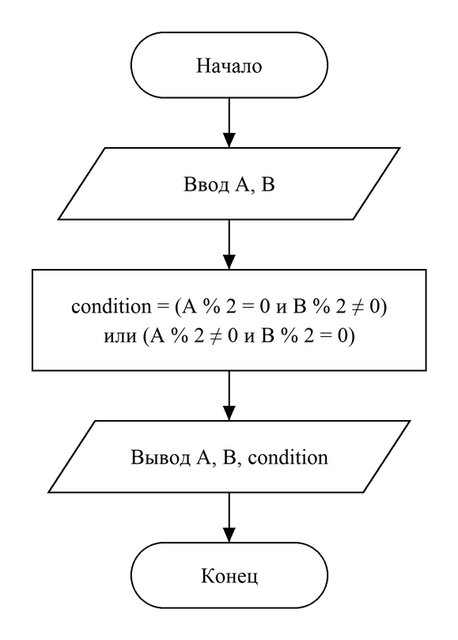

# Домашнее задание к работе №4
Вариант 15

## Условие задачи
**Викторина.** На телевикторине два игрока (A и B) нажали на кнопки. Для победы в раунде нужно, чтобы ровно один из них нажал на кнопку с четным номером. Запишите условие победы в раунде.

## 1. Алгоритм и блок-схема
### Алгоритм:
1. Начало.
2. Объявить переменные:
- **A, B** — номера кнопок, которые нажали игроки;
- **condition** — результат проверки (1 — раунд выигран, 0 — нет).
3. Ввести A и B.
4. Вычислить условие **condition = (A % 2 == 0 && B % 2 != 0) || (A % 2 != 0 && B % 2 == 0)**: четный номер только у A или только у B.
5. Вывести номера кнопок и значение условия.
6. Конец.

### Блок-схема:


## 2. Реализация программы
```c
#define _CRT_SECURE_NO_DEPRECATE
#include <stdio.h>
#include <locale.h>

// Вариант 15. Викторина
// Раунд выигран, если ровно один из двух игроков (A или B) нажал кнопку с четным номером
int main() {
    setlocale(LC_CTYPE, "RUS");
    int A, B;
    int condition;
    printf("=== ТЕЛЕВИКТОРИНА ===\n");
    printf("Введите номера кнопок двух игроков (A B): ");
    scanf("%d %d", &A, &B); // ввод номеров кнопок
    condition = (A % 2 == 0 && B % 2 != 0) || (A % 2 != 0 && B % 2 == 0); // 1, если четный номер ровно у одного игрока, иначе 0
    printf("Номера кнопок: A = %d, B = %d\n", A, B);
    printf("Победа в раунде (1 - да, 0 - нет): %d\n", condition);
    return 0;
}
```

## 3. Результаты работы программы
Случай 1:
```
=== ТЕЛЕВИКТОРИНА ===
Введите номера кнопок двух игроков (A B): 2 5
Номера кнопок: A = 2, B = 5
Победа в раунде (1 - да, 0 - нет): 1
```
Случай 2:
```
=== ТЕЛЕВИКТОРИНА ===
Введите номера кнопок двух игроков (A B): 4 8
Номера кнопок: A = 4, B = 8
Победа в раунде (1 - да, 0 - нет): 0
```
Случай 3:
```
=== ТЕЛЕВИКТОРИНА ===
Введите номера кнопок двух игроков (A B): 3 7
Номера кнопок: A = 3, B = 7
Победа в раунде (1 - да, 0 - нет): 0
```

## 4. Информация о разработчике
Файко Андрей Юрьевич, бТИИ-262
